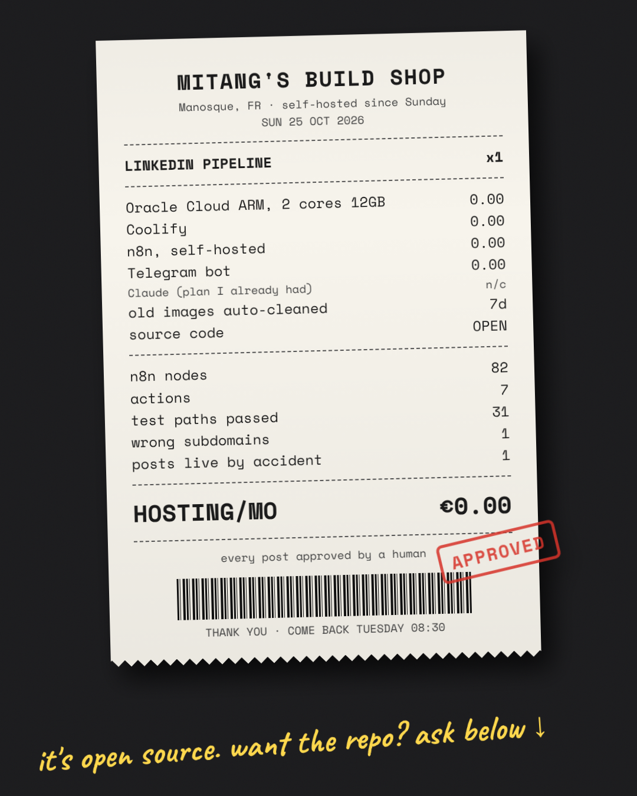
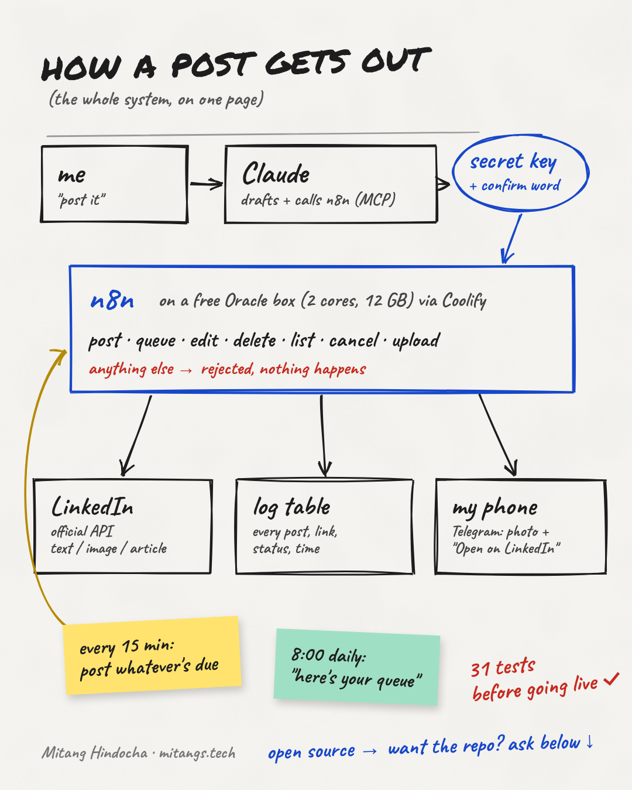
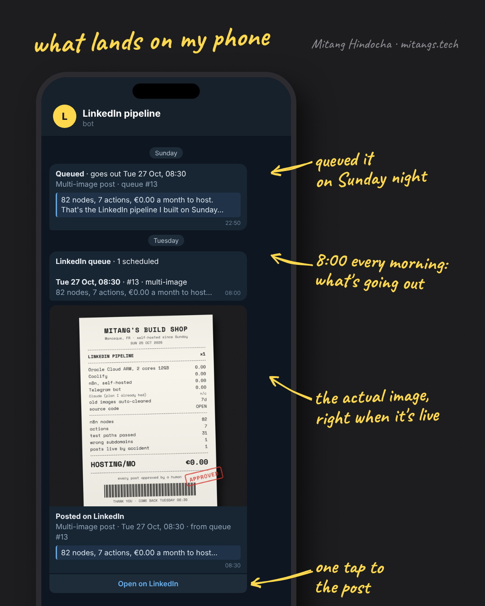

# linkedin-n8n-pipeline

Draft LinkedIn posts with Claude, approve them, and let your own n8n server publish them through LinkedIn's official API.



I write my LinkedIn posts with Claude. When I approve a draft, Claude calls my own n8n server (over n8n's MCP server, or a plain webhook) and n8n publishes it. Everything runs on an Oracle Cloud Always Free ARM VM with Coolify, so hosting costs €0/month.

It is one n8n workflow: 82 nodes, 7 actions. Before going live I ran 31 test paths with simulated data.

## What it does

- Publishes text, single-image, multi-image (2 to 20 images) and article posts
- Queues posts for a set time and publishes them when they're due
- Edits a live post without losing its likes and comments
- Deletes posts and cancels queued ones
- Hosts images on your own server and gives you a public link to use in a post
- Logs every action in an n8n Data Table
- Sends Telegram notifications for everything that happens, plus a daily queue summary
- Cleans up hosted images a week after they're no longer needed

## How it works



Claude sends a JSON request to one webhook. The workflow checks the `X-Claude-Key` header and a confirm word, routes the request by `action`, calls LinkedIn, logs the result and pings you on Telegram.

Three schedules run alongside it:

- **Every 15 minutes:** publishes the oldest due queued post (one per run).
- **08:00 daily:** sends a Telegram summary of the queue. Stays quiet if the queue is empty.
- **03:00 nightly:** empties the hosted images of posts that went live (or were deleted, cancelled or failed) 7 or more days ago. Queued posts are never touched.

Text, single-image and article posts go through n8n's LinkedIn node. Multi-image posts, edits and deletes use LinkedIn's REST API (`/rest/images`, `/rest/posts`) through HTTP Request nodes, with the same LinkedIn credential.



## The 7 actions

All actions go to `POST https://YOUR_N8N_DOMAIN/webhook/claude-linkedin-post`.

| Action | Required fields | Confirm word | What happens |
|---|---|---|---|
| `post` | `text` (optional `image_url`, `image_urls`, or `article_url` + `article_title` + `article_description`) | `POST` | Publishes now |
| `queue` | same as `post` + `scheduled_at` (ISO 8601 with offset) | `QUEUE` | Adds to the queue |
| `edit` | `urn`, `text` | `EDIT` | Replaces the post text, keeps likes and comments |
| `delete` | `urn` | `DELETE` | Deletes the post |
| `list` | none | none | Returns the last 20 log rows |
| `cancel` | `row_id` of a queued post | `CANCEL` | Removes it from the queue |
| `upload` | `filename`, `data_base64` | `UPLOAD` | Saves the image and returns `https://YOUR_N8N_DOMAIN/webhook/media?f=<file>` |

Anything else is rejected and nothing happens. Full request and response details are in [docs/api.md](docs/api.md).

## Requirements

- An Oracle Cloud Always Free account (or any Linux VM you control)
- A domain or subdomain you can point at the VM
- Coolify to deploy n8n
- n8n 2.x with Data Tables. Use 2.13+ if you want Claude to connect over MCP
- A LinkedIn developer app (needs a LinkedIn Company Page)
- A Telegram bot
- Claude, if you want it to drive the pipeline

I run it on 2 OCPU / 12 GB. The free tier allows up to 4 OCPU / 24 GB.

## Quick start

The full version with commands and checkpoints is in [docs/walkthrough.md](docs/walkthrough.md).

1. Create an Ampere A1 Ubuntu VM on Oracle Cloud and open ports 80 and 443. ([Part 1](docs/walkthrough.md#part-1-oracle-cloud-vm))
2. Install Coolify and point a domain at the VM. ([Part 2](docs/walkthrough.md#part-2-coolify-and-a-domain))
3. Deploy the plain N8N service in Coolify and add a volume for media files. ([Parts 3 and 4](docs/walkthrough.md#part-3-deploy-n8n))
4. Create a LinkedIn app and a Telegram bot. ([Parts 5 and 6](docs/walkthrough.md#part-5-linkedin-developer-app))
5. In n8n, add the three credentials and create the `linkedin_posts` data table. ([Parts 7 and 8](docs/walkthrough.md#part-7-n8n-credentials))
6. Replace the placeholders in `workflow/linkedin-pipeline.json`, import it, pick your credentials and set your timezone. ([Part 10](docs/walkthrough.md#part-10-import-the-workflow))
7. Send a request that should be rejected, then a `list` call. ([Part 11](docs/walkthrough.md#part-11-test-it-safely))
8. Optional: connect Claude over MCP. ([docs/claude-mcp.md](docs/claude-mcp.md))

## Safety notes

- **Two locks on every write.** Requests need the `X-Claude-Key` header, and every action that changes something needs its own confirm word. A missing or wrong word means nothing happens.
- **Official API only.** Posts go through LinkedIn's API with your own OAuth app. No scraping, no browser automation.
- **Publishing only.** The workflow does not send DMs, like posts or write comments. It doesn't automate engagement.
- **Tokens expire.** LinkedIn access tokens last 60 days. When posts start failing with auth errors, reconnect the LinkedIn credential in n8n.
- **API version.** The HTTP Request nodes send `LinkedIn-Version: 202608`. LinkedIn supports each version for about a year, so bump it later.
- **Timezone.** The workflow is set to Europe/Paris. Change it to yours in the workflow settings.

## Project layout

```
.
├── README.md
├── LICENSE
├── assets/
│   ├── cover-receipt.png
│   ├── how-it-works.png
│   └── telegram-notifications.png
├── docs/
│   ├── walkthrough.md       setup from zero
│   ├── claude-mcp.md        connect Claude to n8n
│   ├── api.md               every action, request and response
│   ├── how-it-works.md      node by node
│   ├── data-table.md        the linkedin_posts table
│   └── troubleshooting.md
├── examples/                curl scripts, one per action
└── workflow/
    ├── linkedin-pipeline.json
    └── data-table-schema.json
```

## Docs

- [Walkthrough](docs/walkthrough.md)
- [Connect Claude over MCP](docs/claude-mcp.md)
- [API reference](docs/api.md)
- [How it works, node by node](docs/how-it-works.md)
- [Data table](docs/data-table.md)
- [Troubleshooting](docs/troubleshooting.md)
- [Example curl scripts](examples/)

## License

MIT. See [LICENSE](LICENSE).

---

Built by Mitang Hindocha. [LinkedIn](https://www.linkedin.com/in/mitang-hindocha) · [mitangs.tech](https://mitangs.tech)
