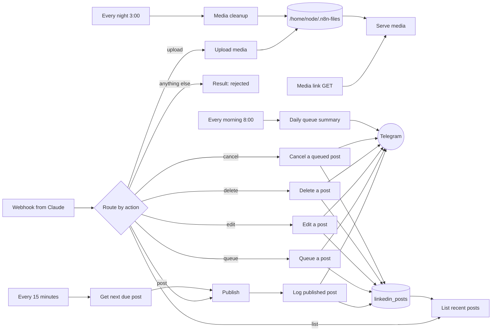

# How it works

The whole pipeline is one n8n workflow, `workflow/linkedin-pipeline.json`, with 82 nodes. It has four entry points:

- `Webhook from Claude`: `POST /webhook/claude-linkedin-post`, the API
- `Media link`: `GET /webhook/media`, serves hosted images
- `Every 15 minutes`, `Every morning 8:00`, `Every night 3:00`: schedules

On the canvas the nodes are arranged in labelled groups. This page goes through them in the order a request flows.

## Router

`Webhook from Claude` checks the `X-Claude-Key` header (n8n Header Auth) and is set to respond with the last node's output, so the caller waits for the whole path to finish and gets its result.

`Route by action` is a Switch with seven rules and a fallback. Each rule checks `action`, the fields that action needs, and its confirm word. The rules are listed in [api.md](api.md#how-a-request-is-routed). Anything that doesn't match goes to `Result: rejected`, which returns `{status: "rejected", reason: ...}` and does nothing else.

## Publish (text / article / image / multi-image)

Used by instant posts and by the queue.

1. `Prepare post` normalises the input. It reads fields from `body` when called from the webhook, or from the table row when called by the scheduler. It sets `media_type` (`MULTI_IMAGE`, `IMAGE`, `ARTICLE` or `NONE`), keeps `image_urls` as a JSON string, and sets `row_id` only for queued rows.
2. `Media type?` sends the item down one of four branches.
3. Text: `LinkedIn: text post` (n8n LinkedIn node).
4. Article: `LinkedIn: article post` (LinkedIn node, with URL, title and description).
5. Single image: `Download image` fetches the file, then `LinkedIn: image post` uploads and posts it.
6. Multi-image, through LinkedIn's REST API:
   - `Image list` and `One item per image` split the URLs into one item each
   - `LinkedIn: init image upload` calls `POST /rest/images?action=initializeUpload` and gets an upload URL and an image URN
   - `Download image (multi)` fetches the file
   - `LinkedIn: upload image` PUTs the bytes to the upload URL
   - `Image URN` and `Collect image URNs` gather the URNs and upload statuses back into one item
   - `All images uploaded?` checks that there are at least 2 URNs and every upload returned 2xx. If not, `Image upload failed` produces a `failed` result with the upload statuses, and nothing is sent to `/rest/posts`
   - `LinkedIn: multi-image post` calls `POST /rest/posts` with `content.multiImage.images`
   - `Multi-image result` reads the new post URN from the `x-restli-id` response header
7. `Post result` merges whichever branch ran into one shape: `status` (`posted` if there is a URN, else `failed`), `urn`, `post_url`, `error`, plus the post fields for logging.

The LinkedIn and download nodes are set to continue on error, so a failure becomes a `failed` result that gets logged and reported instead of stopping the workflow.

The REST calls send `LinkedIn-Version: 202608` and `X-Restli-Protocol-Version: 2.0.0`.

## Log published post

- `From queue?` checks `row_id`. If the post came from the queue, `Log: update queued row` updates that row (`status`, `urn`, `post_url`, `posted_at`, `error`). Otherwise `Log: insert post` adds a new row.
- `Has image? (post)` picks the Telegram message: `Notify: post (photo)` sends the first image with a caption, `Notify: post` sends text. If the photo can't be sent (Telegram couldn't fetch the image, for example), its error output falls through to the text message.
- `Result: post` returns `{status, urn, post_url, error, log_row_id}`.

## Queue a post

- `Log: add to queue` inserts a row with `status: "queued"`, `scheduled_at` and the post fields. It works out `media_type` the same way `Prepare post` does.
- `Has image? (queued)` then `Notify: queued (photo)` or `Notify: queued` tells you when it will go out and its queue number.
- `Result: queued` returns `{status: "queued", row_id, scheduled_at}`.

Nothing is sent to LinkedIn at this point.

## Every 15 minutes

`Every 15 minutes` triggers `Get next due post`, which reads the `linkedin_posts` table for rows with `status = queued` and `scheduled_at <= now`, sorted by `scheduled_at` ascending, limit 1. If it finds one, the row goes into `Prepare post` and follows the same Publish and Log path as an instant post. If nothing is due, the run ends there.

## Edit a post

- `LinkedIn: edit post` sends `POST /rest/posts/{urn}` with `X-RestLi-Method: PARTIAL_UPDATE` and `{patch: {$set: {commentary: ...}}}`. The text is escaped for LinkedIn's "little text" format first (see [api.md](api.md#edit)).
- `Edit result` maps the HTTP status: under 300 is `edited`, anything else `failed`, and keeps LinkedIn's status and body.
- `Edit ok?`
  - yes: `Log: save edited text` updates `text` and `edited_at` on the row with that URN, `Notify: edited`, `Result: edit`
  - no: `Notify: edit failed`, `Result: edit failed`

## Delete a post

- `LinkedIn: delete post` sends `DELETE /rest/posts/{urn}`.
- `Delete result`: 204 is `deleted`, anything else `failed`.
- `Delete ok?`
  - yes: `Log: mark deleted` sets `status: "deleted"`, then `Has image? (deleted)` picks `Notify: deleted (photo)` or `Notify: deleted`, then `Result: delete`
  - no: `Notify: delete failed`, `Result: delete failed`

## List recent posts

`Log: recent posts` reads the last 20 rows by `id`, and `Result: list` wraps them in `{posts: [...]}`. No Telegram message.

## Cancel a queued post

`Log: cancel queued` updates the row with that `id` only if its status is `queued`, setting it to `cancelled`. If no row matched, the output is empty and `Result: cancel` returns `not found or not queued`. The Telegram message says which of the two happened.

## Upload media

- `Prepare upload` builds a safe file name (date, 6 random characters, sanitised original name), strips any `data:...;base64,` prefix and works out the MIME type.
- `Base64 to file` turns the string into a binary file.
- `Save to disk` writes it to `/home/node/.n8n-files/<file_name>`.
- `Result: upload` returns `{status: "uploaded", file_name, url}`. The URL domain comes from the `YOUR_N8N_DOMAIN` placeholder you replaced before importing.

n8n 2.x only lets the file nodes touch `~/.n8n-files` by default, which is why that folder is used. Mount a volume there so files survive container restarts.

## Serve media

`Media link` listens on `GET /webhook/media?f=<file>`.

- `Read media file` reads the file. The name is stripped to `a-z A-Z 0-9 . _ -` with leading dots removed, so a request can't escape the folder. A missing file goes to `Not found`.
- `File still has content?` checks the file size. A 0-byte file (one the cleanup emptied) also goes to `Not found`.
- `Send image` returns the bytes with `Cache-Control: public, max-age=86400`. `Not found` returns 404 `not found`.

## Media cleanup

`Every night 3:00`:

1. `Get all logged posts` reads every row.
2. `Older than 7 days, has media?` keeps rows that:
   - are not `queued`
   - are not already `media_cleaned`
   - have an `image_url` or `image_urls` entry pointing at `/webhook/media?f=`
   - have `posted_at` (or, if empty, `updatedAt`) more than 7 days ago
3. `Media files of post` and `One item per file` list the hosted file names for each row.
4. `Empty content`, `Make empty file` and `Overwrite image with empty file` replace each file with a 0-byte file.
5. `Log: mark media cleaned` sets `media_cleaned: true` on the row. Only successful writes get here: if a write fails, the row stays unmarked and is retried the next night.

External image URLs are never touched. Neither are uploads that were never used in a logged post.

## Daily queue summary

`Every morning 8:00` runs `Get queued posts` (all `queued` rows, soonest first), `Collect queue` and `Notify: daily queue`, which lists each post's time, queue number, type and the first 90 characters of its text. If the queue is empty, `Get queued posts` returns nothing and no message is sent.

## Telegram messages

All messages use HTML parse mode, with user text escaped.

- If the post has an image, the message is a photo with a caption. Captions are limited, so the text is cut to about 700 characters.
- Otherwise it's a text message with the full post text (up to 3,000 characters) in an expandable blockquote.
- Posted, edited, edit-failed and delete-failed messages have an "Open on LinkedIn" button. A failed post has no URN, so its message shows the reason instead.
- Times are shown in the workflow's timezone (Workflow settings → Timezone).

## Design choices

**Confirm words.** The header key proves the request came from you. The confirm word proves the request meant to do this specific thing. A client (or a model) that builds the wrong action, or reuses a body, hits the fallback and nothing happens. `list` has no confirm word because it can't change anything.

**One post per 15 minutes.** The queue publishes at most one post per run. If several posts end up due at the same time, for example after the server was down, they go out 15 minutes apart instead of all at once. It also keeps each run short and easy to read in the executions list.

**Telegram never blocks posting.** Every Telegram node continues on error. If Telegram is down or the chat ID is wrong, the post is still published, logged, and the caller still gets its result. The photo nodes use a separate error output so a failed photo falls back to a plain text message.

**Files are emptied, not deleted.** The Read/Write Files node can read and write but not delete, and the Execute Command node is disabled by default in n8n 2.x. Overwriting with a 0-byte file stays inside n8n's defaults, frees the space, and makes the media link return 404. The empty files are left behind; remove them by hand if you care about the file count.

**Why some calls skip the LinkedIn node.** n8n's LinkedIn node can create text, article and single-image posts, so those use it. It can't edit, delete or create multi-image posts, so those use HTTP Request nodes against LinkedIn's REST API with the same LinkedIn OAuth credential.

**Images are downloaded by n8n.** LinkedIn's API needs the image bytes, not a link. n8n downloads each image and uploads it. The image link only has to be reachable from your server, and the public media link exists mainly so Claude can hand over files it created.

**One table for everything.** Instant posts, queued posts, edits, deletes and cancels all live in `linkedin_posts`. The queue is just rows with `status = queued`. See [data-table.md](data-table.md).
